# Pediline 2.0 — PDV, comandas e delivery em um único SaaS

> Sistema SaaS multi-tenant para restaurantes que une **atendimento presencial** (mesas, balcão, caixa, cozinha) e **delivery** sobre a mesma base de pedidos, produtos, estoque e pagamentos.

🔗 **Demo (catálogo de um estabelecimento fictício):** [pediline.store/pizzaria-bella-massa](https://pediline.store/pizzaria-bella-massa)
🎥 **Vídeo do fluxo completo (garçom → cozinha → caixa):** _[adicionar link]_
📄 **Monografia (TCC — UFV):** _[adicionar link]_

> 🔒 O código-fonte é privado, porque o projeto está sendo preparado para virar produto. Este repositório documenta a arquitetura, as decisões técnicas e os resultados. O código pode ser apresentado em entrevista.

---

## O problema

Muitos restaurantes vendem on-line e no salão ao mesmo tempo, mas usam sistemas diferentes para cada canal. O resultado é estoque divergente, cozinha com duas filas e caixa que não fecha.

O Pediline 2.0 evolui o [Pediline](#créditos), um SaaS de catálogo e delivery, adicionando os módulos de **Ponto de Venda** e **Controle de Unidades de Atendimento**. Um pedido do salão e um pedido do app passam pela mesma fila de produção e baixam o mesmo estoque.

## Funcionalidades

| Área | O que faz |
|---|---|
| **Salão** | Mapa de mesas em tempo real, comandas com itens lançados em envios numerados e status por item (em preparo → pronto → entregue) |
| **App do garçom** | Android/iOS/web (Expo): abrir mesa, lançar itens com variações e observações, receber alerta quando o item fica pronto, fechar e dividir a conta |
| **Cozinha (KDS)** | Fila única por ordem de chegada com pedidos de mesa, balcão, retirada e delivery |
| **PDV / Balcão** | Venda sem mesa, identificada pelo nome do cliente, com pagamento em várias formas e cálculo de troco |
| **Caixa** | Abertura com fundo de troco, sangria, suprimento, ajuste auditado e fechamento com conferência (sobra/falta) |
| **Pagamentos** | Pix, crédito, débito e dinheiro; pagamentos parciais; divisão **igualitária**, **por item** ou **por valor livre** |
| **Estoque** | Toda alteração gera um movimento imutável (venda, devolução, ajuste), com extrato auditável |
| **Histórico** | Linha do tempo de cada pedido e da loja: quem fez o quê, quando e com qual papel |
| **Acesso** | Papéis de gestor, caixa e garçom; módulos habilitáveis por estabelecimento |

## Screenshots

### App do garçom

| Salão em tempo real | Comanda da mesa | Lançamento de itens |
|---|---|---|
| 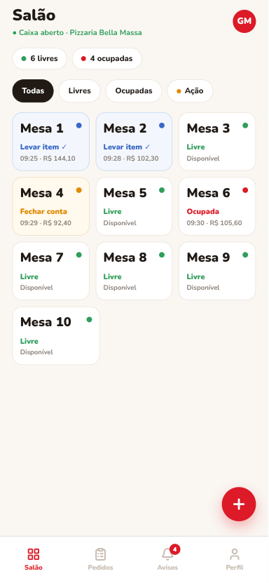 | 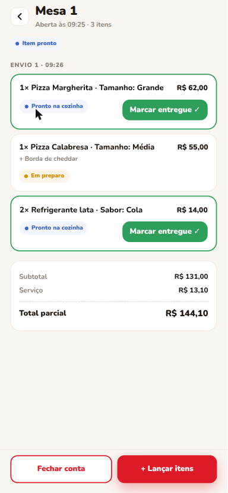 | 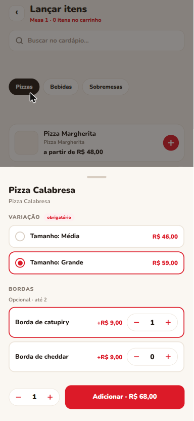 |

| Divisão igualitária | Divisão por item | Avisos |
|---|---|---|
| 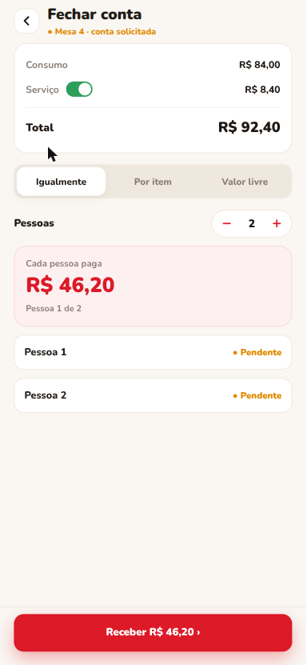 | 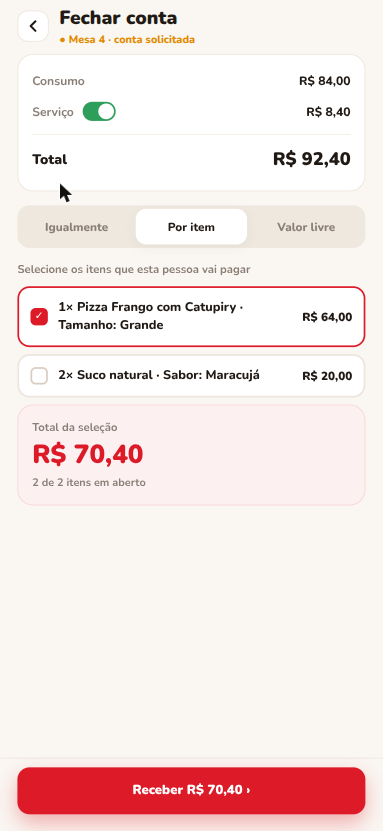 | 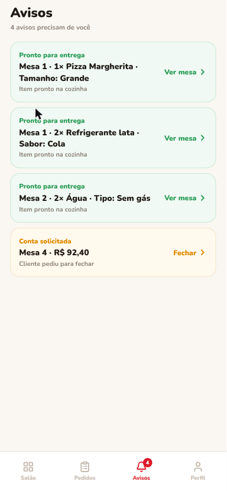 |

### Painel do gestor

**Tela da cozinha (KDS):** fila única com mesas e balcão; itens prontos riscados.

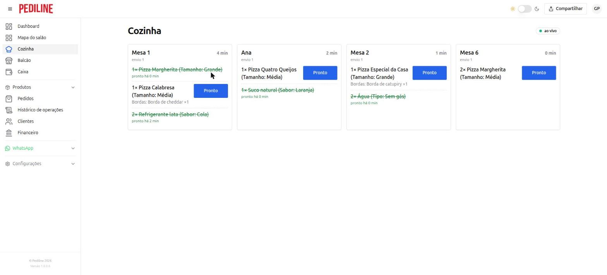

| Mapa do salão | Comanda da mesa |
|---|---|
| 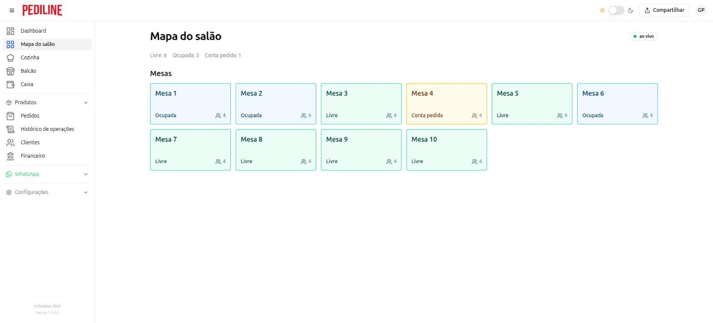 | 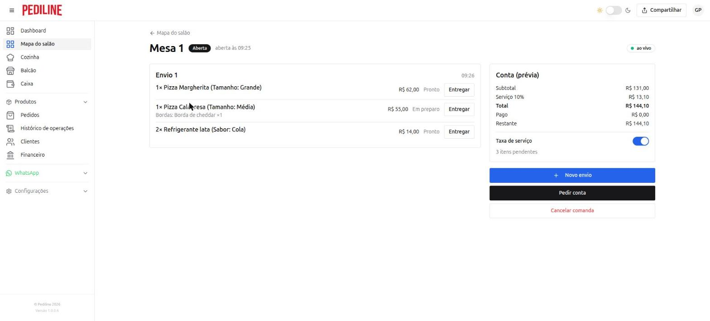 |

| Venda de balcão | Histórico de operações |
|---|---|
| 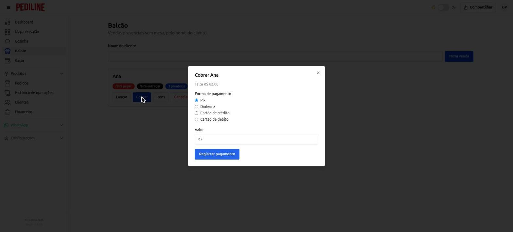 | 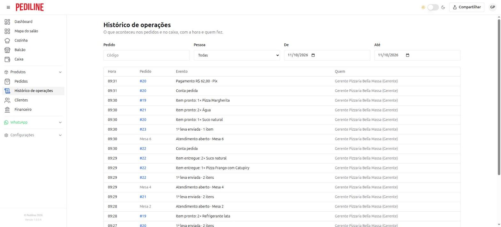 |

### Catálogo do consumidor

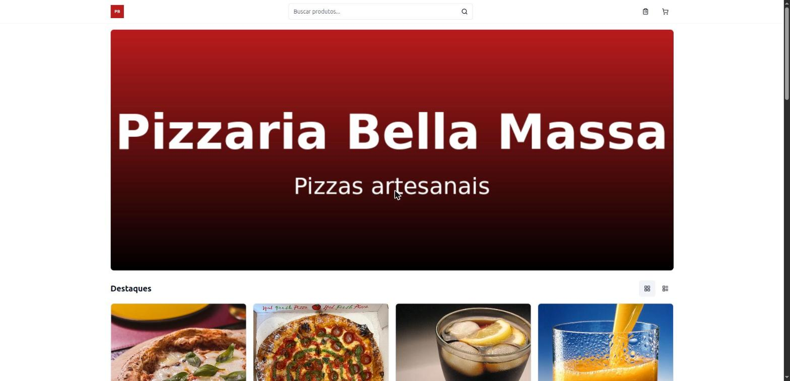

---

## Arquitetura

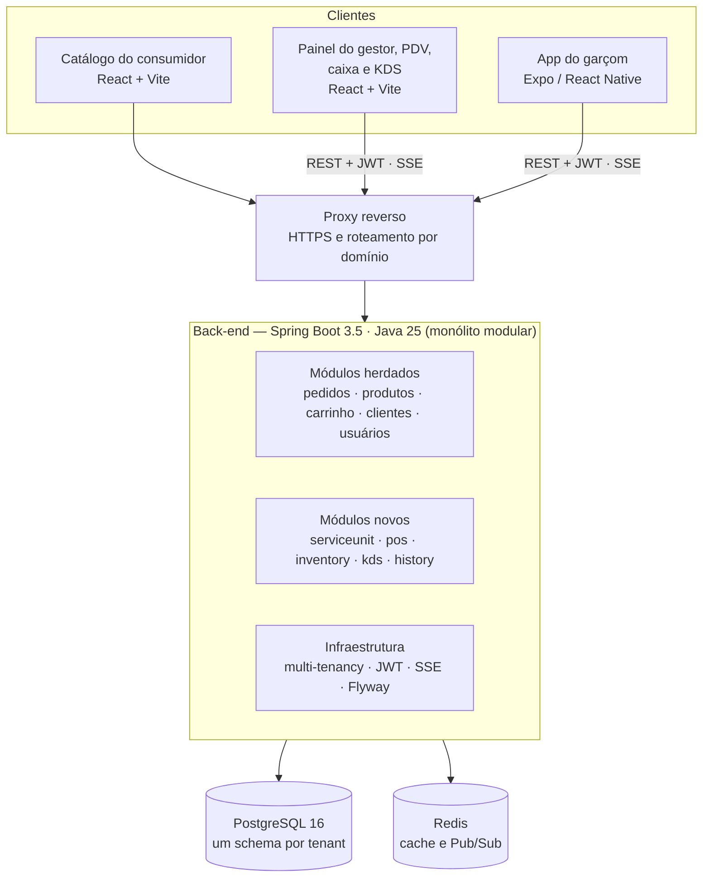

### Decisões técnicas

**1. Monólito modular, não microsserviços**

O sistema herdado já era um monólito modular, organizado por pacotes de domínio. Avaliamos três caminhos: módulos novos dentro do monólito, um serviço separado para PDV e caixa, ou reescrever tudo.

O critério decisivo foi a **consistência**. Registrar um pagamento, baixar estoque e fechar o caixa mexem com dinheiro e contagem física. Em um único banco, cada operação é uma **transação ACID**. Distribuídas, exigiriam sagas com compensação e janelas em que o estoque estaria baixado sem o pagamento registrado.

Os benefícios clássicos de microsserviços (escalar e implantar módulos separadamente, autonomia de equipes) não se aplicavam: equipe de duas pessoas e nenhuma diferença de carga entre PDV e delivery. As fronteiras entre módulos são explícitas por interfaces, o que mantém aberta a extração futura de um serviço se surgir uma necessidade mensurável.

**2. A comanda é um único pedido**

Uma mesa recebe vários pedidos ao longo da noite. Consideramos três modelos:
- cada envio vira um pedido;
- a comanda é um pedido com itens em envios;
- a comanda é uma entidade separada, convertida em pedido no fechamento.

Escolhemos **um pedido por comanda**, com itens em envios numerados e status próprio. Assim uma mesa conta como uma venda, as métricas existentes (ticket médio, relatórios) continuam corretas e a divisão por item é natural. O custo foram dois eixos de status, do pedido e do item, o que levou à tela de cozinha com fila por item e, depois, à fila única entre todos os canais.

**3. Concorrência: lock pessimista com ordem fixa**

Vários garçons podem operar a mesma mesa ao mesmo tempo. Toda operação que altera uma comanda começa com `SELECT ... FOR UPDATE` na sessão, e as operações concorrentes são serializadas.

Na baixa de estoque, as variações de produto são travadas sempre **em ordem crescente de id**. Isso evita deadlock quando dois envios disputam os mesmos produtos e impede que a última unidade seja vendida duas vezes.

**4. Pagamentos idempotentes**

Em rede instável, o app pode reenviar um pagamento cuja resposta não chegou. Cada pagamento carrega um cabeçalho `Idempotency-Key` gerado pelo cliente, com restrição única no banco. Se a requisição é repetida, o servidor devolve o pagamento já registrado em vez de cobrar de novo.

**5. Multi-tenancy por schema**

Cada estabelecimento tem seu próprio schema no PostgreSQL. Um filtro identifica o tenant a partir do JWT, e o Hibernate seleciona o schema antes de qualquer comando. As tabelas novas não precisam de coluna de tenant nem de filtros nas consultas: uma migração Flyway é aplicada automaticamente a todos os schemas.

**6. Tempo real só depois do commit**

Mudanças no salão e na cozinha são publicadas em um canal Redis por tenant e entregues por **Server-Sent Events**. A publicação acontece **após o commit da transação**, para que nenhum aparelho seja avisado de uma alteração desfeita. O cliente recebe o aviso e relê os dados pela API.

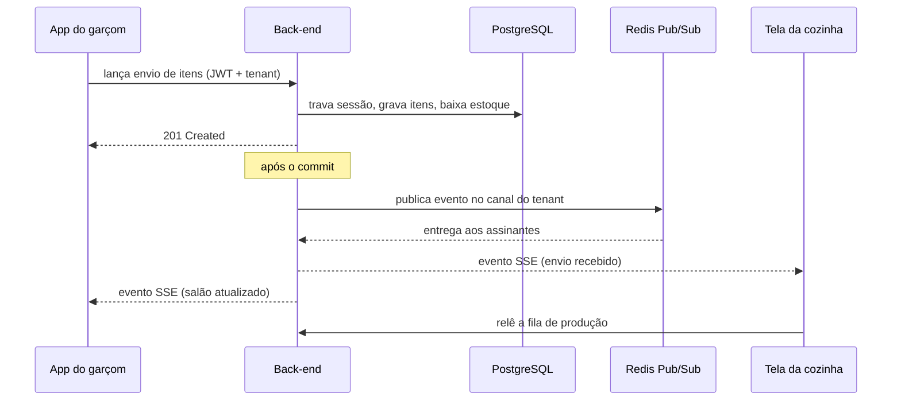

### Estados

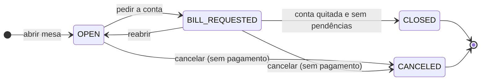

O status de cada mesa não é armazenado. Livre, ocupada ou com conta pedida são **derivados da sessão ativa**, o que elimina estados divergentes entre mesa e comanda. As transições só acontecem pelos métodos da própria entidade, com restrições no banco como última barreira.

---

## Qualidade e testes

| Repositório | Ferramentas | Testes |
|---|---|---|
| Back-end | JUnit 5, Mockito, Testcontainers | 1.603 |
| Painel do gestor | Vitest, Testing Library | 875 |
| App do garçom | Jest, jest-expo, Testing Library | 376 |
| Catálogo | Vitest, Testing Library | 52 |
| **Total** | | **2.906** |

No início do projeto, o back-end tinha 317 testes, todos de unidade com mocks, e os front-ends não tinham nenhum.

Mocks não provam isolamento entre tenants nem comportamento de locks. Por isso adicionamos **48 classes de testes de integração com PostgreSQL real** via Testcontainers, usando as mesmas migrações da produção. Elas verificam:
- dados de um tenant invisíveis a partir de outro;
- envios simultâneos na mesma comanda numerados em sequência, sem perda de itens;
- dois pedidos simultâneos que não vendem a mesma última unidade;
- pagamentos concorrentes que não ultrapassam o saldo da conta;
- o fluxo completo da mesa, da abertura ao encerramento, conferindo estoque e caixa no banco.

Todos os testes rodam a cada PR no GitHub Actions, e nenhum PR é incorporado com falha.

## Teste de carga

O cenário simula o pico de sábado à noite de um restaurante médio: **40 mesas, 8 garçons, cozinha, caixa e delivery**, com conexões SSE abertas e releitura a cada aviso, como os apps reais fazem. Foi executado com **k6** e monitorado com **Prometheus + Grafana**.

Critérios de aceitação: p95 < 500 ms e erros < 1%. Ao fim de cada rodada, um script comparou o banco com o registro do k6 para detectar qualquer pedido, item ou pagamento perdido ou duplicado.

A primeira execução revelou dois gargalos, identificados com `pg_stat_statements`:
1. **Falta de índices** na tabela de itens do pedido. Cada leitura do salão e da cozinha percorria a tabela inteira.
2. **Consultas N+1** na lista do salão. Na rodada de pico, cada consulta por comanda rodou cerca de 235 mil vezes em 30 minutos. A correção foi carregar tudo em uma consulta por tipo de dado, com um teste que garante que o número de consultas não cresce com o número de mesas.

| p95 (ms) | Escrita antes | Escrita depois | Leitura antes | Leitura depois |
|---|---|---|---|---|
| Pico (1x) | 125 | **70** | 218 | **70** |
| Folga (3x) | 140 | **85** | 280 | **72** |
| Limite (até 20x) | 3.478 | **118** | 597 | **97** |
| 20 lojas, 3 em pico | 595 | **387** | 720 | **433** |

- **Capacidade de uma loja:** de 8x para **mais de 20x** a carga do pico, sem atingir o limite.
- **Integridade:** 0% de erros e **nenhum registro perdido ou duplicado** em todas as rodadas.

Rodada de limite no Grafana, na mesma escala. Antes das correções, o tempo de resposta sobe junto com as conexões esperando o banco; depois, fica próximo de zero durante toda a rodada.

| Antes das correções | Depois das correções |
|---|---|
| 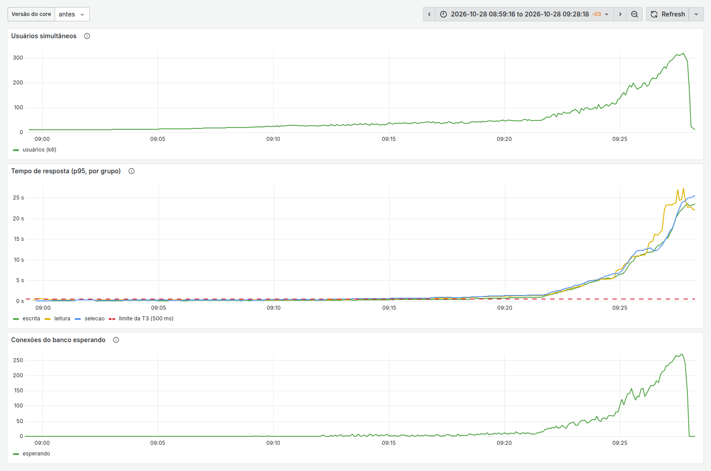 | 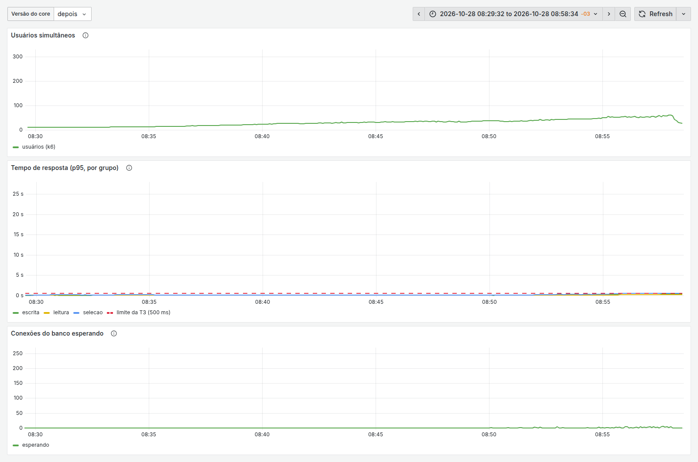 |

## Infraestrutura

- Contêineres Docker orquestrados com Docker Compose em uma VM na nuvem: back-end, PostgreSQL, Redis, armazenamento de imagens e proxy reverso com HTTPS automático.
- Limite de memória por serviço e backup diário do banco com retenção de 7 dias.
- **CI/CD com GitHub Actions:**
  - testes e verificação de segredos a cada PR;
  - na promoção para homologação, build da imagem, deploy e health check, com **rollback automático** se o serviço não ficar saudável em 5 minutos;
  - front-ends publicados por versão, com troca atômica e as três últimas mantidas para retorno imediato.

## Stack

**Back-end:** Java 25, Spring Boot 3.5, Spring Security (JWT), Hibernate/JPA, PostgreSQL 16, Flyway, Redis
**Front-end:** React, Vite, TypeScript · **Mobile:** Expo / React Native
**Testes:** JUnit 5, Mockito, Testcontainers, Vitest, Jest, Testing Library, k6
**Infra:** Docker, Docker Compose, GitHub Actions, GHCR, Prometheus, Grafana, Azure

---

## Autores

Desenvolvido como Trabalho de Conclusão de Curso em Sistemas de Informação na **Universidade Federal de Viçosa — Campus Rio Paranaíba** (2026), com atuação de ambos em todas as camadas, da arquitetura à implementação.

- **Arthur Roberto de Paula Neto** — [GitHub](https://github.com/arthurneto2) · [LinkedIn](https://www.linkedin.com/in/arthurneto-dev)
- **John Kauan Oliveira Passos** — _[links]_

Orientação: Profa. Liziane Santos Soares.

## Créditos

O Pediline 2.0 é a evolução do **Pediline** (Brener e Guilherme, 2024), SaaS de catálogo e delivery desenvolvido como TCC na mesma instituição.
